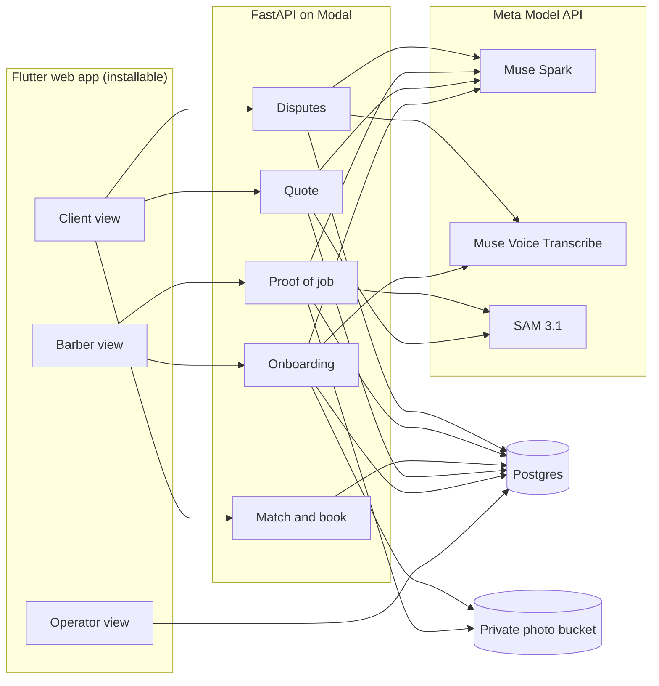

# Architecture

One Python backend serves the Flutter web app, calls three Meta models and writes every verdict, with its evidence, to Postgres. Proof of job is the only path to a payout or a rating. Every other module feeds it.

## Stack

| Layer | Choice | Why |
| --- | --- | --- |
| App | Flutter web, installable (barber, client and operator views) | Judges open a link; live camera and GPS for proof of job |
| Backend | Python FastAPI on Modal | Meta's cookbook is in Python; Modal web endpoints serve the app API |
| Models | Muse Spark, Muse Voice Transcribe and SAM 3.1 via the Meta Model API | Every judged AI job runs on a Meta model |
| Database | Postgres (Supabase free tier) | Relational jobs and evidence; quick to stand up |
| Photo storage | Private bucket, signed URLs | Faces are never public |
| Operator dashboard | Flutter web | Same codebase as the app |
| Build tools | Muse Code + Claude Code | Muse Code use is shown in the README |

## Data model

| Table | Key fields |
| --- | --- |
| `barbers` | id, name, area, languages, tier, price_band, verified_jobs, rating, status |
| `portfolio_items` | barber_id, before_url, after_url, scores (json), reasons |
| `clients` | id, phone, area |
| `jobs` | id, barber_id, client_id, cut, minutes, quote_zar, travel_band, slot, status |
| `evidence` | job_id, before_url, after_url, masks (json), checks (json), verdict, reasons, model_versions |
| `booking_requests` | quote_id, client_id, day, windows (json), chosen_barber_id, offered_until, broadcast_at, declined_by (json), status, job_id |
| `ratings` | job_id, stars, comment (insert allowed only when verdict = pass) |
| `disputes` | job_id, transcript, summary, outcome |

Photo URLs point into the private bucket and are served only through short-lived signed URLs.

## Proof-of-job verdict rule

- **Pass** = same person AND hair region changed AND cut matches the order, each with a model reason stored.
- **Uncertain** on any check sends the job to operator review. A job is never auto-failed on camera. The operator's decision is stored as the verdict, with their reason.
- Payment release and rating insert both read the verdict. Nothing else can trigger them.

Capture rules that feed the verdict:

- Live camera only; no gallery uploads.
- Timestamp within the booking slot; GPS within range of the booking address.
- Fallback if camera or GPS permissions fail on a device: photo upload with a time check, flagged for operator review.
